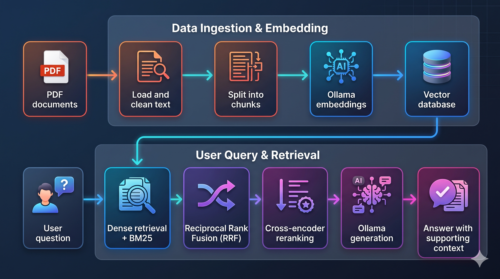

# AI Research Paper Assistant

A RAG application for asking questions about research papers, with a Streamlit interface, a FastAPI backend, and configurable retrieval and generation components.

## Overview

The application turns PDF documents into searchable chunks, retrieves evidence for each question, and generates an answer using the retrieved context. The prompt asks the model to cite sources as `(source:page)` when available and to acknowledge when the documents do not contain an answer.

### How it works



### Main components

| Component | Implementation |
| --- | --- |
| Interface | Streamlit chat with PDF/folder path input and session chat history |
| API | FastAPI endpoints for ingestion, generation, and health checks |
| Ingestion | PDF loading, text cleaning, chunking, embedding, and storage |
| Retrieval | Dense similarity search and custom BM25, combined using Reciprocal Rank Fusion |
| Reranking | Sentence Transformers cross-encoder |
| Generation | Ollama model prompted with the question and retrieved context |
| Storage | Supabase PostgreSQL with pgvector; a Qdrant adapter is also implemented |
| Evaluation | Retrieval metrics and RAGAS context/answer metrics |

The current defaults in `configs/app_configs.yml` are:

| Setting | Value |
| --- | --- |
| Embedding model | `qwen3-embedding:8b` |
| Embedding dimensions | `1024` |
| Generation model | `qwen3.5:2b` |
| Temperature | `0.0` |
| Chunking | Recursive, 1,200 characters with 120-character overlap |
| Reranker | `BAAI/bge-reranker-v2-m3`, running on CPU |
| Retrieved candidates before reranking | `10` |
| Chunks retained after reranking | `5` |

`retrieval.rrf_k` controls the number of fused results passed to reranking. It is separate from the RRF scoring constant used inside the retriever.

### Project structure

```text
app.py                         Streamlit interface and API client
configs/                       Model, retrieval, and vector-store configuration
src/
  api/                         FastAPI application and routes
  pipeline/                    PipelineFactory, ingestion pipeline, and RAG chain
  ingestion/                   PDF loading and text preprocessing
  chunker/                     Recursive, semantic, and hierarchical chunkers
  embedder/                    Embedding model wrappers
  retriever/                   Dense, BM25, and hybrid retrieval
  reranker/                    Cross-encoder reranking
  generation/                  LLM wrappers and grounding prompt
  database/                    pgvector and Qdrant adapters
  evaluation/                  Retrieval metrics and RAGAS evaluation
notebooks/                     Dataset preparation, benchmarking, and visualization
data/                          Local evaluation datasets and saved results
papers/                        Local research PDFs
sql/init.sql                   Database initialization script for Supabase
```

Chat history is kept in the current Streamlit session. It is not persisted to a database or sent to the RAG backend as conversational context. Each question is answered independently, and the API returns a complete answer rather than a token stream.

## Benchmark

The benchmark compares four retrieval configurations. The tables below summarize the existing CSV files in these local folders; they are saved experiment results, not a new benchmark run.

| Configuration | Result folder | Retrieval method |
| --- | --- | --- |
| Dense | `data/results_dense/` | Dense similarity search |
| Dense + rerank | `data/results_dense_rerank/` | Dense search followed by cross-encoder reranking |
| Hybrid | `data/results_hybrid/` | Dense search + BM25 + RRF |
| Hybrid + rerank | `data/results_hybrid_rerank/` | Hybrid retrieval followed by cross-encoder reranking |

### Evaluation setup

Retrieval and answer quality are evaluated on different datasets:

- **Retrieval:** the [BEIR SciFact corpus](https://huggingface.co/datasets/BeIR/scifact), using the test relevance judgments from [SciFact qrels](https://huggingface.co/datasets/BeIR/scifact-qrels). The notebook embeds scientific abstracts and evaluates retrieved document IDs. It uses `top_k=5` and a candidate pool of `50` for reranking.
- **Context and answer quality:** 100 question/reference-answer pairs covering five papers: ArcFace, Attention Is All You Need, MobileFaceNets, TinyLlama, and YOLO. Each paper contributes 20 questions: 7 easy, 7 medium, and 6 hard. The source questions are in `data/eval/`; generated contexts and answers are in `data/eval_data_*.json`.

The dataset-generation notebook configures `qwen3.5:2b` for answers, `qwen3-embedding:8b` with 1,024-dimensional embeddings, and recursive chunks of 1,200 characters with 50-character overlap. The benchmark notebook configures `llama3.1` as the evaluator LLM and `embeddinggemma:300m` as the evaluator embedding model. These notebook settings differ from some current application defaults.

### Retrieval results

Values come directly from each folder's `retrieve_results.csv`, rounded to four decimal places. Higher is better.

| Configuration | Precision@5 | Recall@5 | Hit@5 | MRR | MAP | nDCG@5 |
| --- | ---: | ---: | ---: | ---: | ---: | ---: |
| Dense | 0.1840 | 0.8204 | 0.8333 | 0.7134 | 0.7025 | 0.7357 |
| Dense + rerank | 0.1700 | 0.7696 | 0.7867 | 0.6732 | 0.6588 | 0.6907 |
| Hybrid | 0.1847 | 0.8238 | 0.8367 | 0.7103 | 0.6993 | 0.7341 |
| Hybrid + rerank | 0.1700 | 0.7696 | 0.7867 | 0.6732 | 0.6588 | 0.6907 |

Precision measures the fraction of the top five results that are relevant; recall measures the fraction of relevant documents retrieved; hit rate measures whether any relevant document is retrieved. MRR, MAP, and nDCG measure ranking quality. MRR and MAP are computed over the returned top-five lists; the hybrid CSV labels those columns `mrr@5` and `map@5`.

In these saved runs, hybrid retrieval slightly improves precision, recall, and hit rate over dense retrieval, while dense retrieval has slightly higher MRR, MAP, and nDCG.

### Context and answer quality

Values are arithmetic means over all 100 rows of each `context_gen_results.csv`. Higher metric scores are better.

| Configuration | Context precision | Faithfulness | Factual correctness | Evaluation time (min/sample) |
| --- | ---: | ---: | ---: | ---: |
| Dense | 0.9409 | 0.5204 | 0.4894 | 2.0051 |
| Dense + rerank | 0.9561 | 0.6129 | 0.5206 | 2.1087 |
| Hybrid | 0.9388 | 0.5341 | 0.5006 | 1.9323 |
| Hybrid + rerank | 0.9561 | 0.6129 | 0.5206 | 2.1087 |

Context precision evaluates the relevance and ordering of retrieved context. Faithfulness evaluates whether answer claims are supported by that context. Factual correctness evaluates the answer against its reference answer.

The CSV `Time` column measures the time spent scoring a sample with the evaluator, in minutes. It does **not** measure retrieval or chatbot response latency.

[//]: # (### Result notes and reproduction)

[//]: # ()
[//]: # (- The `retrieve_results.csv` and `context_gen_results.csv` files in `results_dense_rerank/` and `results_hybrid_rerank/` are currently identical, byte for byte. Their repeated scores should not be treated as independent evidence that the two methods perform equally.)

[//]: # (- `results_hybrid_rerank/retrieve_results_lib.csv` contains an additional saved retrieval result. It is excluded from the four-configuration comparison above.)

[//]: # (- `data/` and `papers/` are excluded by `.gitignore`. Supply the evaluation artifacts and PDFs locally when reproducing these experiments.)

The notebooks document the workflow:

1. `notebooks/create_eval_datasets.ipynb` loads paper questions, retrieves contexts, generates answers, and exports evaluation JSON files.
2. `notebooks/benchmark.ipynb` builds the SciFact retrieval corpus, computes retrieval metrics, scores the saved answers with RAGAS, and exports CSV results.
3. `notebooks/visualization.ipynb` reads the result folders and plots comparisons.

Update the notebooks' absolute local paths before running them. Use a separate benchmark database: the preparation and benchmark notebooks contain calls that clear the vector store before inserting their evaluation corpus. Some notebook cells use CUDA; select CPU if CUDA is unavailable.

## Installation (Conda)

### 1. Prerequisites

Install [Miniconda or Anaconda](https://docs.conda.io/projects/conda/en/stable/user-guide/install/index.html) and [Ollama](https://docs.ollama.com/quickstart), and create a [Supabase](https://supabase.com/) account.

Run the following commands from the repository root. The setup below uses Supabase PostgreSQL with pgvector and Python 3.12. The source uses Python 3.12-compatible f-string syntax.

### 2. Create the Conda environment

```bash
conda create -n paper-assistant python=3.12 -y
conda activate paper-assistant
pip install -r requirements.txt
```

The Qdrant client is needed because the database package imports both adapters, even when pgvector is selected. See the [Conda environment guide](https://docs.conda.io/projects/conda/en/stable/user-guide/tasks/manage-environments.html) for environment management.

### 3. Create the Supabase database

1. Create a project in the [Supabase Dashboard](https://supabase.com/dashboard).
2. Open the project's **SQL Editor**.
3. Copy the contents of the existing `sql/init.sql` file into a new query and run it to initialize the vector extension and document table.

Keep the vector dimension in the table consistent with `embedding.options.dimensions` in `configs/app_configs.yml`.

### 4. Configure the environment variables

In your Supabase project, click **Connect**, select **Session pooler**, and copy the PostgreSQL connection string. Replace its password placeholder with your project's database password. See the [Supabase connection guide](https://supabase.com/docs/guides/database/connecting-to-postgres) for details.

Create `.env` in the repository root using `.env.example` as a template:

```dotenv
PG_DATABASE_URL=[YOUR_SUPABASE_POSTGRES_CONNECTION_STRING]

# Optional: only needed when using Qdrant instead of Supabase.
# QDRANT_DATABASE_URL=[YOUR_QDRANT_URL]
# QDRANT_DATABASE_API_KEY=[YOUR_QDRANT_API_KEY]
```

Set `PG_DATABASE_URL` to the complete PostgreSQL URI copied from Supabase, including the username, password, host, port, and database name. URL-encode reserved characters in the password and use `sslmode=require` in the connection string. Leave `vector_store.default_provider` set to `pgvector` in `configs/vectordb_config.yml`.

### 5. Customize the app configuration

Open [configs/app_configs.yml](configs/app_configs.yml) and choose the models and pipeline settings you want to use before preparing the models.

| Configuration key | What to customize |
| --- | --- |
| `embedding.model_name` | Ollama model used to embed documents and questions |
| `embedding.options.dimensions` | Embedding vector size; must match the database column |
| `embedding.options.num_ctx` | Context window used by the embedding model |
| `llm.model_name` | Ollama model used to generate answers |
| `llm.temperature` | Generation temperature |
| `llm.options` | Model options such as `reasoning` and `num_predict` |
| `chunking` | Chunking strategy, chunk size, and overlap |
| `reranker.model_name` | Sentence Transformers cross-encoder model |
| `reranker.device` | Device used for reranking, such as `cpu` or `cuda` |
| `retrieval.rrf_k` | Number of fused retrieval results passed to reranking |
| `retrieval.rerank_k` | Number of reranked chunks included in the answer context |

The current factory supports `ollama` for the embedding and LLM providers and `sentence_transformers` for the reranker provider. Keep `1 <= retrieval.rerank_k <= retrieval.rrf_k`. Recursive chunk sizes and overlaps are measured in characters.

Changing the embedding model or its dimensions requires regenerating the stored embeddings and keeping the database vector column compatible. Restart the API after changing the app configuration so the pipeline loads the new settings.

### 6. Prepare the models

Use the model names selected in [Customize the app configuration](#5-customize-the-app-configuration). Download the Ollama models specified by `embedding.model_name` and `llm.model_name`. For the default configuration, run:

```bash
ollama pull qwen3-embedding:8b
ollama pull qwen3.5:2b
```

If Ollama is not already running, start it in another terminal:

```bash
ollama serve
```

The application uses the local Ollama service. See the [Ollama CLI reference](https://docs.ollama.com/cli) for model and server commands. The cross-encoder is downloaded through Sentence Transformers when reranking is first used, so that first request may take longer.

If you choose different models in the configuration, replace the names in the `ollama pull` commands accordingly. The reranker uses `reranker.model_name` and is downloaded separately by Sentence Transformers.

### 7. Start the API and Streamlit app

In the first terminal:

```bash
conda activate paper-assistant
python -m uvicorn src.api.main:app --host 127.0.0.1 --port 8000
```

In a second terminal, from the same repository root:

```bash
conda activate paper-assistant
streamlit run app.py
```

Open the [Streamlit app](http://localhost:8501). The UI uses `http://127.0.0.1:8000` as its API address. You can also open the [API documentation](http://127.0.0.1:8000/docs) or the [health endpoint](http://127.0.0.1:8000/health).

| Method | Endpoint | Purpose |
| --- | --- | --- |
| `GET` | `/health` | Report initialized backend components |
| `POST` | `/ingestion/ingest_file` | Ingest up to 10 PDF paths with `{"paths": [...]}` |
| `POST` | `/ingestion/ingest_dir` | Ingest a folder with `{"dir_path": "..."}` |
| `POST` | `/generation/generate` | Answer a question with `{"question": "..."}` |

In the sidebar, select **PDF files** or **Folder**, enter paths accessible to the backend, and click **Add documents**. Folder ingestion reads PDFs directly inside that folder; it does not recursively scan subfolders. Once the documents are available, ask a question in the chat.

The current API constructs its RAG pipeline and in-memory BM25 index at startup. After adding documents, restart the API process to rebuild that index, especially when starting from an empty database. The dense search uses the database directly, while the BM25 index otherwise retains the corpus loaded at startup.

### 8. Optional: run the benchmark notebooks

Install the notebook tools and additional experiment dependencies in the same environment:

```bash
python -m pip install jupyterlab ipykernel matplotlib seaborn rank-bm25 openai
python -m ipykernel install --user --name paper-assistant --display-name "Python (paper-assistant)"
ollama pull llama3.1
ollama pull embeddinggemma:300m
python -m jupyterlab
```

Select the **Python (paper-assistant)** kernel, supply the local datasets and papers, update notebook paths, and follow the workflow in the Benchmark section. Keep experiment database contents separate from the documents used by the application.
